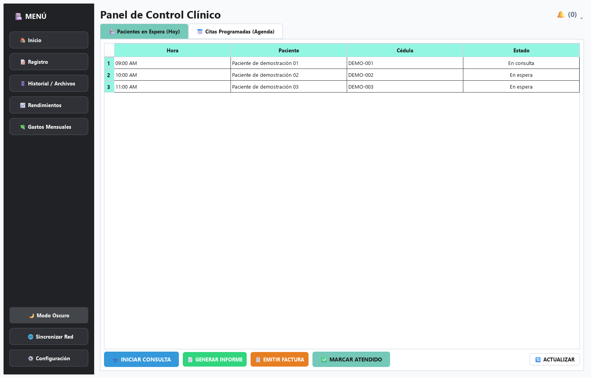
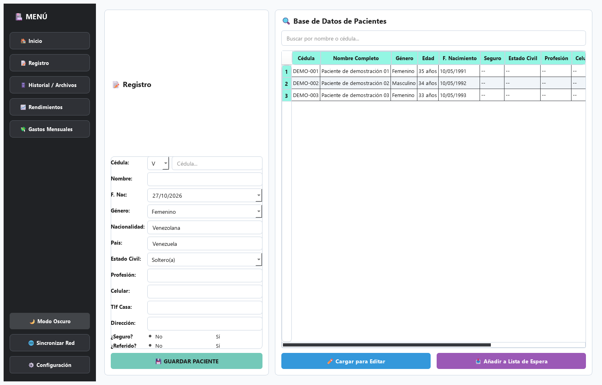
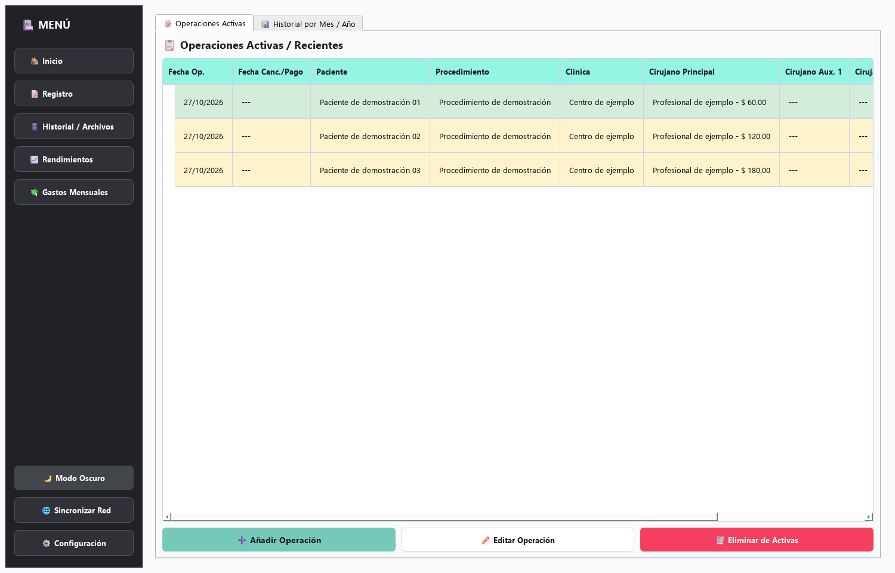

# Helixys · Gestión de historias médicas

Aplicación de escritorio en **Python y PySide6** que reúne el registro de pacientes, la atención de consultas, la generación de documentos y el seguimiento administrativo de un consultorio.

**Proyecto de portafolio de [Paolo Adrián Farías Farías](https://github.com/HerodeSS14)** · Caracas, Venezuela



> Las capturas utilizan exclusivamente datos ficticios. Esta publicación es una muestra técnica del proyecto y se evalúa en un entorno de desarrollo.

## El problema

En un consultorio, la información del paciente, la agenda, los informes y los cobros forman parte del mismo trabajo diario. Helixys los organiza en una interfaz de escritorio y relaciona los registros mediante una base de datos, para facilitar la consulta del historial y la preparación de documentos.

## Funcionalidades

| Área | Implementación |
| --- | --- |
| Pacientes | Ficha de identificación, antecedentes y búsqueda de registros. |
| Atención médica | Lista de espera, citas, consultas y evolución clínica. |
| Documentos | Recetas, órdenes, informes, consentimientos, egresos y notas operatorias; generación de PDF y Word. |
| Administración | Facturación, gastos mensuales y seguimiento de rendimientos y honorarios. |
| Acceso | Inicio de sesión y vistas diferenciadas para médico y asistente. |
| Red local | Descubrimiento del servidor mediante mDNS y conexión a PostgreSQL. |
| Voz | Dictado con Vosk y PyAudio; refinamiento de texto opcional mediante Gemini. |
| Interfaz | Navegación por módulos y temas claro y oscuro. |

## Capturas

Las imágenes se renderizan desde las clases reales de PySide6, usando SQLite en memoria únicamente como entorno de prueba. El arranque habitual de la aplicación utiliza PostgreSQL.

### Registro de pacientes



### Rendimientos y honorarios



## Tecnologías

| Componente | Tecnología |
| --- | --- |
| Lenguaje e interfaz | Python 3.12, PySide6 / Qt |
| Persistencia | PostgreSQL, SQLAlchemy y psycopg2 |
| Documentos y exportación | ReportLab, python-docx y openpyxl |
| Contraseñas de acceso | bcrypt |
| Reconocimiento de voz | Vosk y PyAudio |
| Descubrimiento en red | Zeroconf / mDNS |
| Integración opcional | SDK `google-generativeai` |

## Organización del código

| Archivos | Responsabilidad |
| --- | --- |
| `main.py` | Arranque, ventana principal, navegación y selección de vistas por rol. |
| `ui_*.py` | Pantallas, formularios y acciones de cada módulo. |
| `models.py` | Entidades, relaciones y esquema con SQLAlchemy. |
| `database.py`, `migrar.py` | Configuración de conexión y actualización del esquema. |
| `servicios_impresion.py`, `logic_pdf.py` | Generación de documentos. |
| `motor_voz.py`, `asistente_ia.py` | Captura de audio, transcripción y procesamiento opcional de texto. |
| `servicio_mdns.py`, `automatizacion_servidor.py` | Descubrimiento y configuración de conectividad local. |
| `estilos.py` | Estilos compartidos y temas de la interfaz. |

El flujo principal es **pantallas → sesiones SQLAlchemy → modelos → PostgreSQL**. Los módulos de impresión y voz acompañan el flujo de atención. [Detalles de arquitectura y decisiones](docs/arquitectura.md).

## Ejecutar en desarrollo

Entorno de referencia: **Windows y Python 3.12**. Algunas funciones utilizan servicios y APIs exclusivos de Windows.

```powershell
git clone https://github.com/HerodeSS14/helixys-portfolio.git
cd helixys-portfolio
py -3.12 -m venv .venv
.\.venv\Scripts\python.exe -m pip install -r requirements.txt
Copy-Item .env.example .env
```

1. Crea un usuario y una base PostgreSQL exclusivos para desarrollo, con permiso para crear y modificar tablas dentro de esa base. Puedes usar pgAdmin.
2. Completa `DB_USER`, `DB_PASSWORD`, `DB_HOST`, `DB_PORT` y `DB_NAME` en tu `.env`. Usa `ROL_PC=principal` para una sola computadora. La conexión actual construye una URL: los caracteres reservados en usuario o contraseña requieren codificación URL.
3. Desde la raíz del repositorio, inicia la aplicación:

```powershell
.\.venv\Scripts\python.exe main.py
```

El arranque crea el esquema y aplica las migraciones existentes. En una base vacía crea los accesos iniciales `doctor` / `admin123` y `secretaria` / `12345`. Son accesos de desarrollo: cámbialos desde Configuración antes de cualquier uso compartido.

Si PostgreSQL no responde, se abre el asistente de conexión. El respaldo SQLite en memoria de `database.py` es transitorio y no sustituye una base persistente para el uso normal.

### Dictado e integración opcional

El dictado requiere un micrófono y un modelo de reconocimiento de Vosk dentro de `model/`, con sus subcarpetas directamente en esa ubicación. El modelo binario se descarga por separado desde la [página oficial de Vosk](https://alphacephei.com/vosk/models).

`GEMINI_API_KEY` puede quedar vacía. Si se configura, el refinamiento envía el texto transcrito a un servicio externo. En esta muestra utiliza solo información ficticia. La disponibilidad de modelos y del SDK externo debe revisarse antes de habilitar esa integración.

### Verificación

```powershell
.\.venv\Scripts\python.exe -m unittest discover -s tests -v
```

Las pruebas trabajan con SQLite temporal y no cargan el `.env` ni conectan con PostgreSQL. Comprueban relaciones del modelo, contraseñas y construcción de las vistas de médico y asistente. [Alcance de la validación](docs/validacion.md).

## Alcance de esta publicación

Esta copia se publica con un historial nuevo: contiene el código de la aplicación, recursos visuales, documentación y pruebas. Excluye credenciales, bases de datos, archivos de pacientes, documentos generados, modelos de voz y ejecutables. El instalador histórico y su script de aprovisionamiento se omiten; la configuración reproducible de esta muestra se realiza con `.env.example` y PostgreSQL de desarrollo.

Antes de usar el sistema con información real deben revisarse el almacenamiento de credenciales de recuperación, las cuentas iniciales, los permisos de base de datos y la configuración automática de red. El módulo de red heredado puede habilitar autenticación `trust` y abrir el firewall; no se necesita para la evaluación local. [Limitaciones y mejoras pendientes](docs/arquitectura.md#limitaciones-y-mejoras-pendientes).

## Para el currículum

**Helixys — Aplicación de gestión médica**  
Desarrollo de una aplicación de escritorio con Python, PySide6, PostgreSQL y SQLAlchemy para gestionar pacientes, consultas, agenda y documentos clínicos. Implementación de generación de PDF y Word, módulos de facturación y rendimientos, vistas por rol y dictado por voz con Vosk.

Código: [github.com/HerodeSS14/helixys-portfolio](https://github.com/HerodeSS14/helixys-portfolio)

## Autor y condiciones de uso

**Paolo Adrián Farías Farías** · [GitHub](https://github.com/HerodeSS14)

Se conserva el [EULA original](eula.txt). Esta publicación no añade una licencia de código abierto ni modifica los derechos del proyecto.
